# NEON VERTIGO 3.7 — TRACK MAPS

Código `fd9c5a8c6a3e5856cb8ef6a0e7b0ef9ac2212c4b`, SHA-256 `4c56f772883dd79393a8a72f03546ecffc21cf337ed264508d63db05eb1d82f7`. Trece pistas originales, 18 ramales. Coordenadas a/b son fracciones de L, no distancias del ramal. Longitudes reales derivadas de makeRoute; tiempos de seis semillas, sólo segmentos que terminaron sin wreck. No equivalen a esperanza de tiempo incluyendo recuperaciones.

## k9 — KOWLOON-9

Seed de geometría: `90210`. L=3044.14 m; semiancho 15 m; tráfico inicial de la captura 21. Las pruebas de carrera se registran por separado.

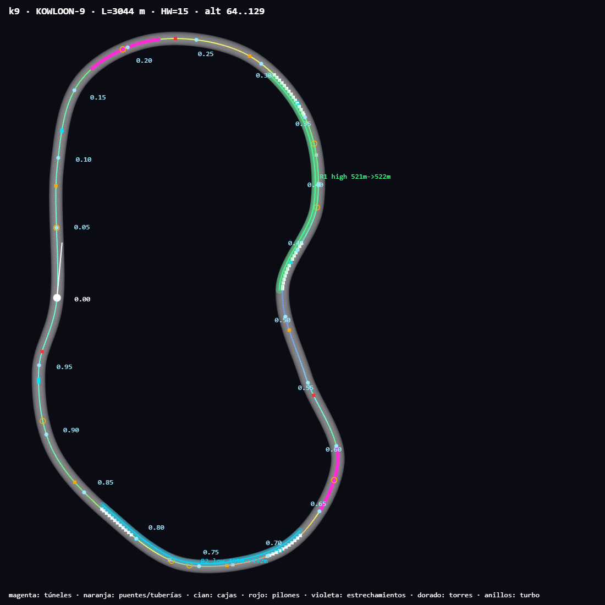

| ID | Nombre | Tipo/lado | a → b | Principal m | Ramal real m | Tiempo ramal/avenida s (n) |
| --- | --- | --- | --- | ---: | ---: | --- |
| k9:R1 | PASAJE AÉREO NEÓN | high/derecha | 0.31 → 0.481 | 520.55 | 522.26 | 3.8 (28) / 4.39 (27) |

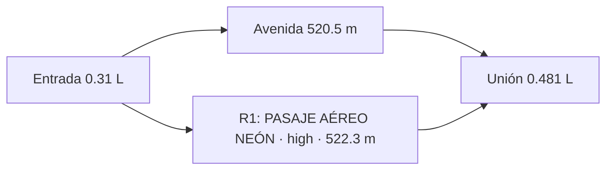

Banda propia -5..7 m, semiancho 8 m; 2 obstáculos, 1 pads y 0 strips definidos. Separación física sSep=1059.80, unión física sJoin=1348.11. routeValidate: sin conflictos detectados. Ambos recorridos tienen pruebas dirigidas, progreso y respawn. La decoración/cámara se capturó en navegador; su comodidad requiere prueba manual.

| ID | Nombre | Tipo/lado | a → b | Principal m | Ramal real m | Tiempo ramal/avenida s (n) |
| --- | --- | --- | --- | ---: | ---: | --- |
| k9:R2 | TÚNEL DEL MERCADO | low/derecha | 0.67 → 0.834 | 499.24 | 492.43 | 3.81 (22) / 4 (47) |

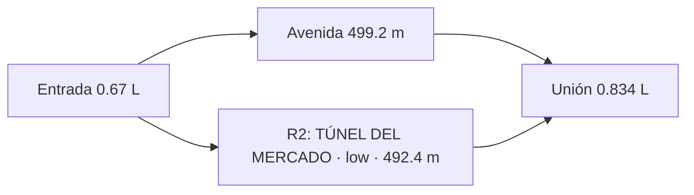

Banda propia -4..5 m, semiancho 7 m; 2 obstáculos, 1 pads y 1 strips definidos. Separación física sSep=2133.43, unión física sJoin=2444.95. routeValidate: sin conflictos detectados. Ambos recorridos tienen pruebas dirigidas, progreso y respawn. La decoración/cámara se capturó en navegador; su comodidad requiere prueba manual.

## ia — INDUSTRIAL ABYSS

Seed de geometría: `4471`. L=2988.96 m; semiancho 12 m; tráfico inicial de la captura 13. Las pruebas de carrera se registran por separado.

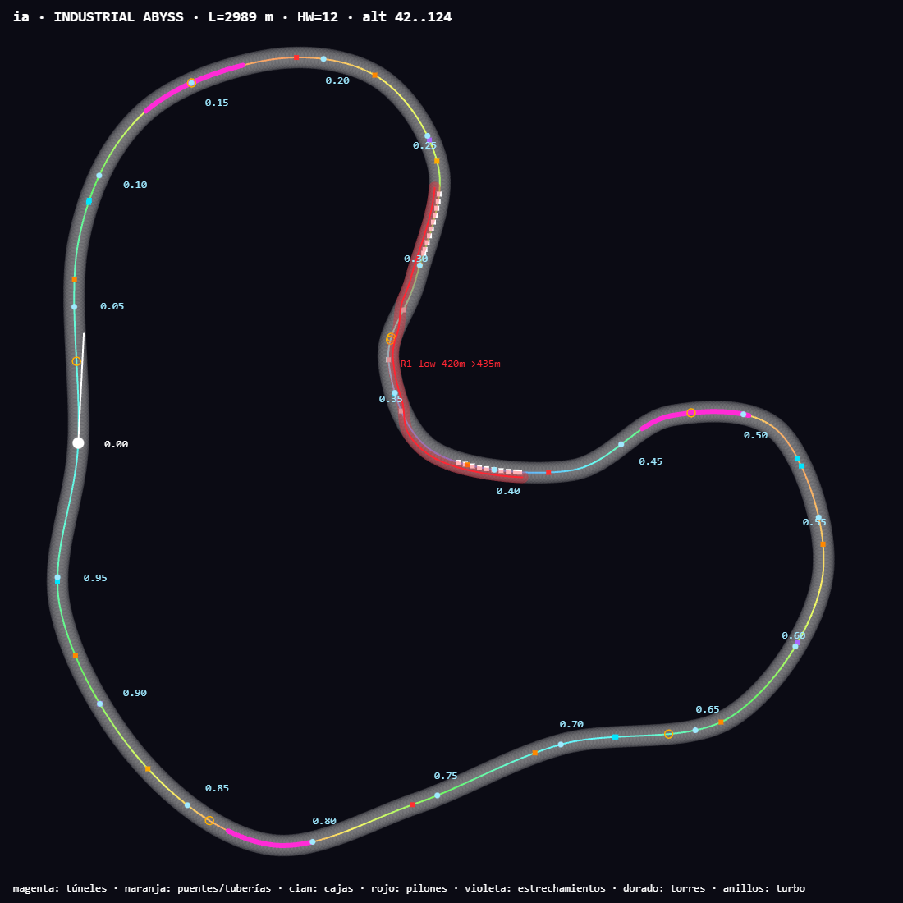

| ID | Nombre | Tipo/lado | a → b | Principal m | Ramal real m | Tiempo ramal/avenida s (n) |
| --- | --- | --- | --- | ---: | ---: | --- |
| ia:R1 | TÚNEL DE MANTENIMIENTO 7 | low/derecha | 0.27 → 0.4105 | 419.95 | 435.04 | 3.76 (4) / 3.95 (72) |

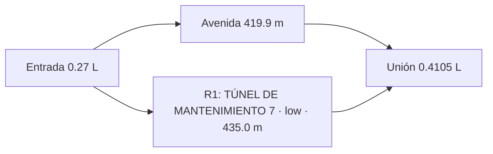

Banda propia -4..5 m, semiancho 6.5 m; 3 obstáculos, 1 pads y 0 strips definidos. Separación física sSep=883.01, unión física sJoin=1150.98. routeValidate: sin conflictos detectados. Ambos recorridos tienen pruebas dirigidas, progreso y respawn. La decoración/cámara se capturó en navegador; su comodidad requiere prueba manual.

## sv — SKYLINE VELOCITY

Seed de geometría: `7331`. L=4666.57 m; semiancho 18 m; tráfico inicial de la captura 24. Las pruebas de carrera se registran por separado.

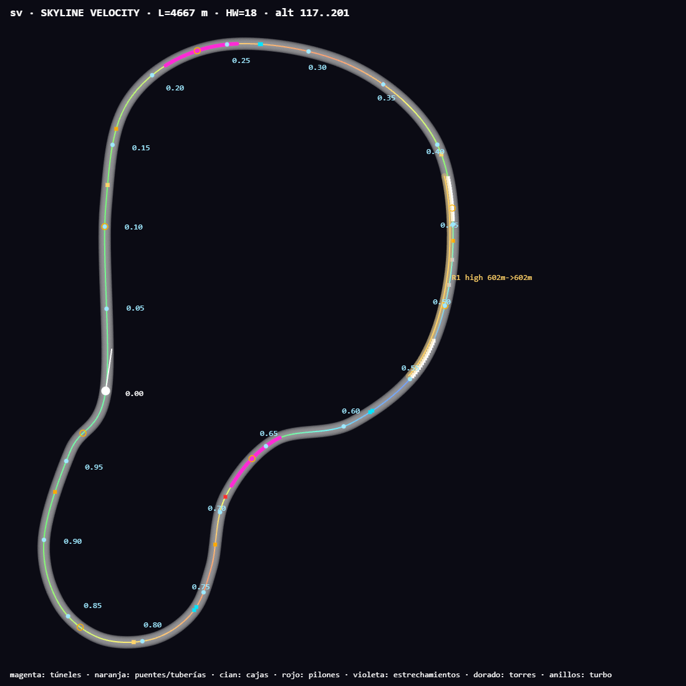

| ID | Nombre | Tipo/lado | a → b | Principal m | Ramal real m | Tiempo ramal/avenida s (n) |
| --- | --- | --- | --- | ---: | ---: | --- |
| sv:R1 | AUTOPISTA EJECUTIVA | high/derecha | 0.42 → 0.549 | 601.99 | 601.60 | 4.15 (27) / 3.78 (43) |

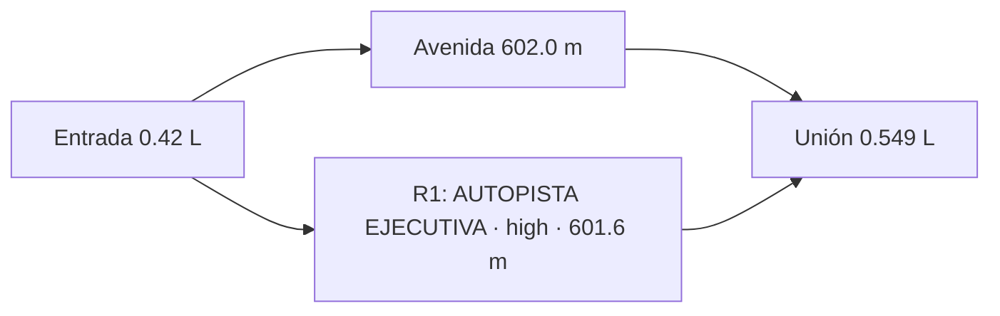

Banda propia -5..8 m, semiancho 9 m; 2 obstáculos, 1 pads y 0 strips definidos. Separación física sSep=2087.96, unión física sJoin=2433.95. routeValidate: sin conflictos detectados. Ambos recorridos tienen pruebas dirigidas, progreso y respawn. La decoración/cámara se capturó en navegador; su comodidad requiere prueba manual.

## k9a — NEON RUSH

Seed de geometría: `11021`. L=4450.82 m; semiancho 15 m; tráfico inicial de la captura 28. Las pruebas de carrera se registran por separado.

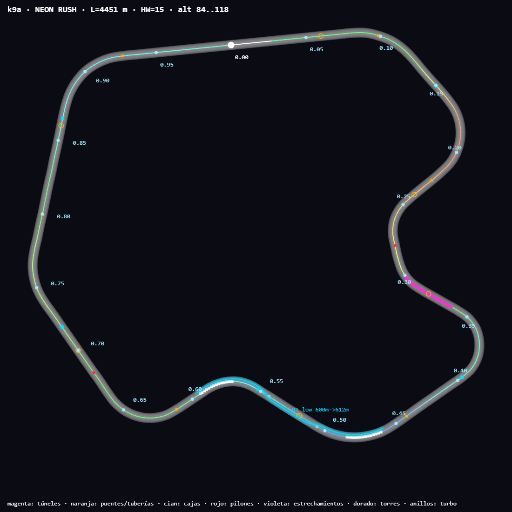

| ID | Nombre | Tipo/lado | a → b | Principal m | Ramal real m | Tiempo ramal/avenida s (n) |
| --- | --- | --- | --- | ---: | ---: | --- |
| k9a:R1 | CALLE DE SERVICIO DE LOS FANGS | low/derecha | 0.46 → 0.5948 | 599.97 | 611.73 | 4.56 (38) / 4.5 (33) |

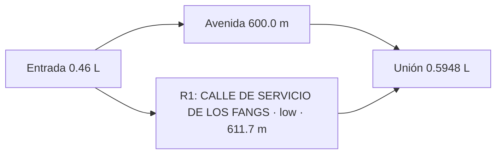

Banda propia -4..5 m, semiancho 7 m; 2 obstáculos, 1 pads y 1 strips definidos. Separación física sSep=2159.37, unión física sJoin=2535.35. routeValidate: sin conflictos detectados. Ambos recorridos tienen pruebas dirigidas, progreso y respawn. La decoración/cámara se capturó en navegador; su comodidad requiere prueba manual.

## k9b — KOWLOON LABYRINTH

Seed de geometría: `22077`. L=4747.33 m; semiancho 15 m; tráfico inicial de la captura 25. Las pruebas de carrera se registran por separado.

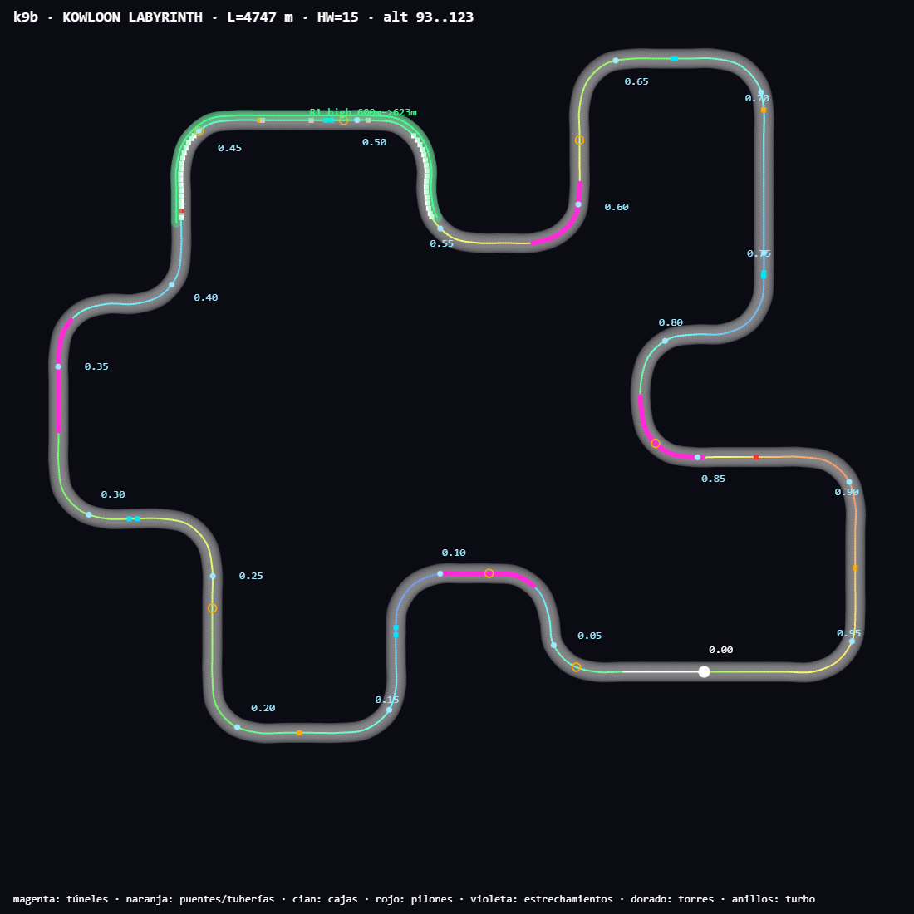

| ID | Nombre | Tipo/lado | a → b | Principal m | Ramal real m | Tiempo ramal/avenida s (n) |
| --- | --- | --- | --- | ---: | ---: | --- |
| k9b:R1 | PUENTE DE CABLES | high/izquierda | 0.42 → 0.5464 | 600.06 | 623.41 | 4.63 (54) / 4.52 (14) |

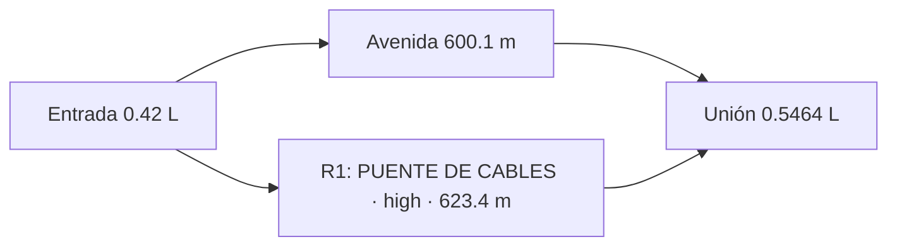

Banda propia -5..7 m, semiancho 8 m; 3 obstáculos, 1 pads y 0 strips definidos. Separación física sSep=2127.89, unión física sJoin=2459.93. routeValidate: sin conflictos detectados. Ambos recorridos tienen pruebas dirigidas, progreso y respawn. La decoración/cámara se capturó en navegador; su comodidad requiere prueba manual.

## k9c — BEAGLE'S CROWN

Seed de geometría: `33119`. L=5454.42 m; semiancho 15 m; tráfico inicial de la captura 31. Las pruebas de carrera se registran por separado.

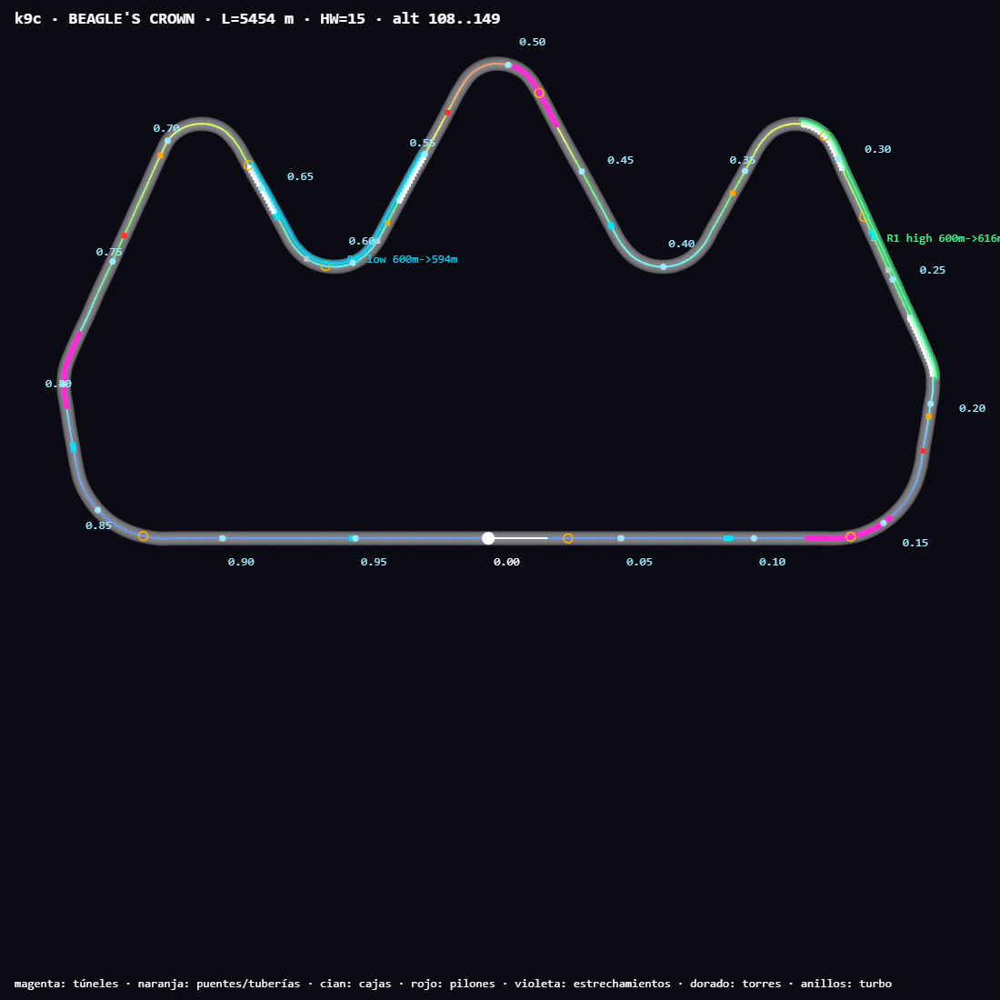

| ID | Nombre | Tipo/lado | a → b | Principal m | Ramal real m | Tiempo ramal/avenida s (n) |
| --- | --- | --- | --- | ---: | ---: | --- |
| k9c:R1 | AVENIDA DE LAS TORRES-CORONA | high/derecha | 0.21 → 0.32 | 599.99 | 616.42 | 4.53 (8) / 4.69 (29) |

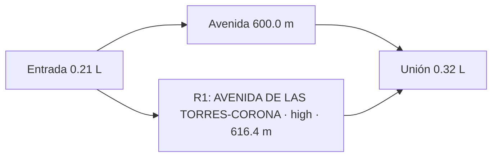

Banda propia -5..7 m, semiancho 8 m; 2 obstáculos, 1 pads y 0 strips definidos. Separación física sSep=1279.43, unión física sJoin=1611.42. routeValidate: sin conflictos detectados. Ambos recorridos tienen pruebas dirigidas, progreso y respawn. La decoración/cámara se capturó en navegador; su comodidad requiere prueba manual.

| ID | Nombre | Tipo/lado | a → b | Principal m | Ramal real m | Tiempo ramal/avenida s (n) |
| --- | --- | --- | --- | ---: | ---: | --- |
| k9c:R2 | ATAJO DE LOS FANGS | low/derecha | 0.55 → 0.66 | 599.99 | 593.75 | 4.29 (12) / 4.63 (18) |

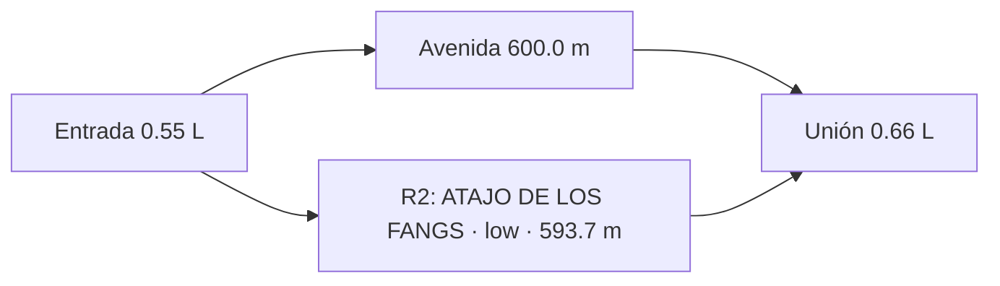

Banda propia -4..5 m, semiancho 7 m; 2 obstáculos, 1 pads y 0 strips definidos. Separación física sSep=3111.93, unión física sJoin=3487.92. routeValidate: sin conflictos detectados. Ambos recorridos tienen pruebas dirigidas, progreso y respawn. La decoración/cámara se capturó en navegador; su comodidad requiere prueba manual.

## iaa — FOUNDRY RUN

Seed de geometría: `44103`. L=4304.66 m; semiancho 12 m; tráfico inicial de la captura 15. Las pruebas de carrera se registran por separado.

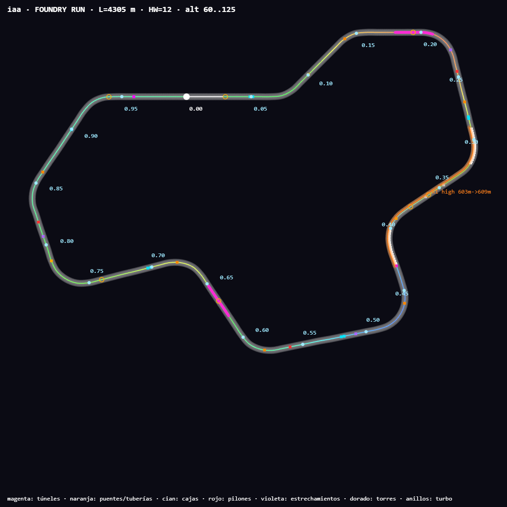

| ID | Nombre | Tipo/lado | a → b | Principal m | Ramal real m | Tiempo ramal/avenida s (n) |
| --- | --- | --- | --- | ---: | ---: | --- |
| iaa:R1 | PLATAFORMA DE CARGA | high/derecha | 0.29 → 0.43 | 602.65 | 609.30 | 5.18 (25) / 5.15 (48) |

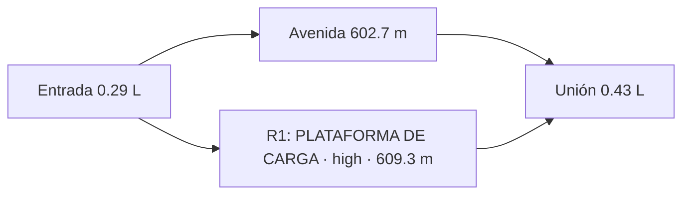

Banda propia -5..7 m, semiancho 7 m; 2 obstáculos, 1 pads y 0 strips definidos. Separación física sSep=1372.48, unión física sJoin=1726.87. routeValidate: sin conflictos detectados. Ambos recorridos tienen pruebas dirigidas, progreso y respawn. La decoración/cámara se capturó en navegador; su comodidad requiere prueba manual.

## iab — STEEL INFERNO

Seed de geometría: `55117`. L=4700.77 m; semiancho 12 m; tráfico inicial de la captura 13. Las pruebas de carrera se registran por separado.

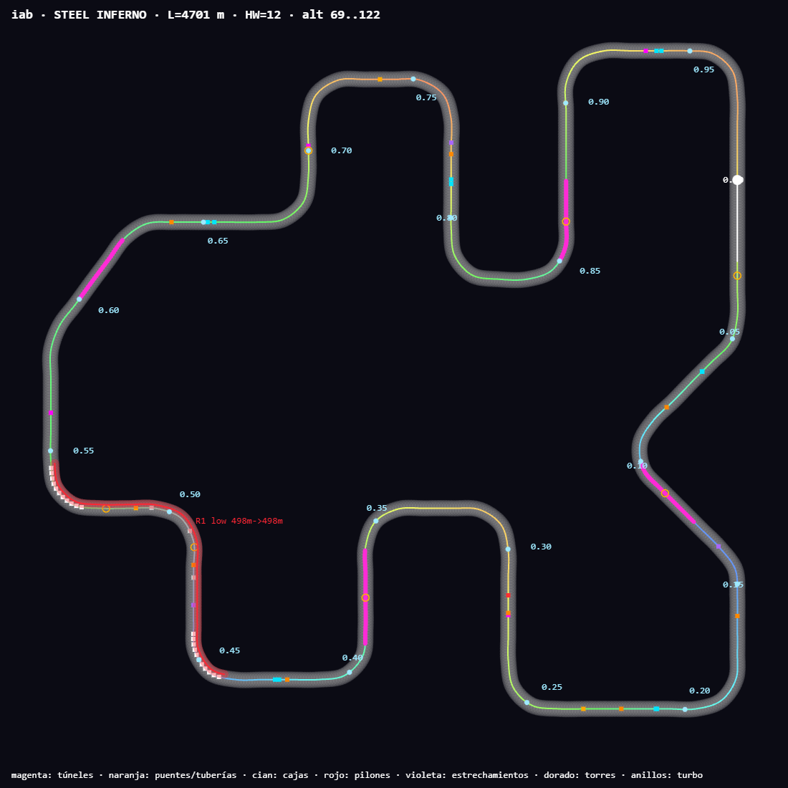

| ID | Nombre | Tipo/lado | a → b | Principal m | Ramal real m | Tiempo ramal/avenida s (n) |
| --- | --- | --- | --- | ---: | ---: | --- |
| iab:R1 | BAJO LAS TUBERÍAS | low/derecha | 0.44 → 0.546 | 498.28 | 498.02 | 4.63 (32) / 4.68 (43) |

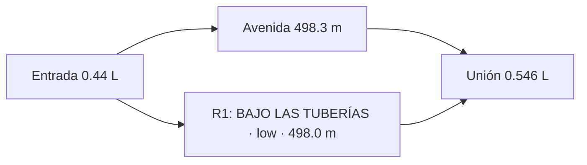

Banda propia -4..5 m, semiancho 6.5 m; 3 obstáculos, 1 pads y 0 strips definidos. Separación física sSep=2158.39, unión física sJoin=2476.57. routeValidate: sin conflictos detectados. Ambos recorridos tienen pruebas dirigidas, progreso y respawn. La decoración/cámara se capturó en navegador; su comodidad requiere prueba manual.

## iac — IRON DOMINION

Seed de geometría: `66131`. L=5301.65 m; semiancho 12 m; tráfico inicial de la captura 15. Las pruebas de carrera se registran por separado.

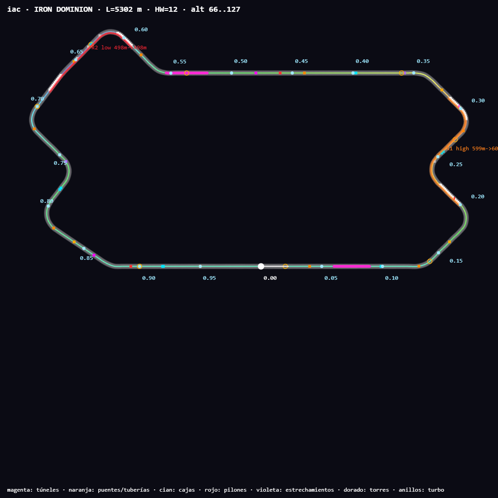

| ID | Nombre | Tipo/lado | a → b | Principal m | Ramal real m | Tiempo ramal/avenida s (n) |
| --- | --- | --- | --- | ---: | ---: | --- |
| iac:R1 | PASARELA DE GRÚAS | high/izquierda | 0.2 → 0.313 | 599.09 | 608.73 | 5.35 (17) / 5.09 (18) |

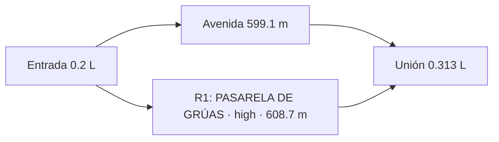

Banda propia -5..7 m, semiancho 7 m; 1 obstáculos, 1 pads y 0 strips definidos. Separación física sSep=1184.14, unión física sJoin=1535.61. routeValidate: sin conflictos detectados. Ambos recorridos tienen pruebas dirigidas, progreso y respawn. La decoración/cámara se capturó en navegador; su comodidad requiere prueba manual.

| ID | Nombre | Tipo/lado | a → b | Principal m | Ramal real m | Tiempo ramal/avenida s (n) |
| --- | --- | --- | --- | ---: | ---: | --- |
| iac:R2 | CORREDOR DE CARGA | low/izquierda | 0.59 → 0.684 | 498.36 | 497.85 | 4.04 (18) / 3.84 (17) |

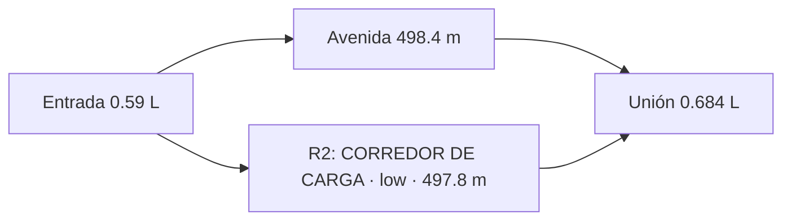

Banda propia -4..5 m, semiancho 6.5 m; 3 obstáculos, 1 pads y 0 strips definidos. Separación física sSep=3218.04, unión física sJoin=3536.27. routeValidate: sin conflictos detectados. Ambos recorridos tienen pruebas dirigidas, progreso y respawn. La decoración/cámara se capturó en navegador; su comodidad requiere prueba manual.

## sva — GOLDEN SKYLINE

Seed de geometría: `77141`. L=6601.89 m; semiancho 18 m; tráfico inicial de la captura 29. Las pruebas de carrera se registran por separado.

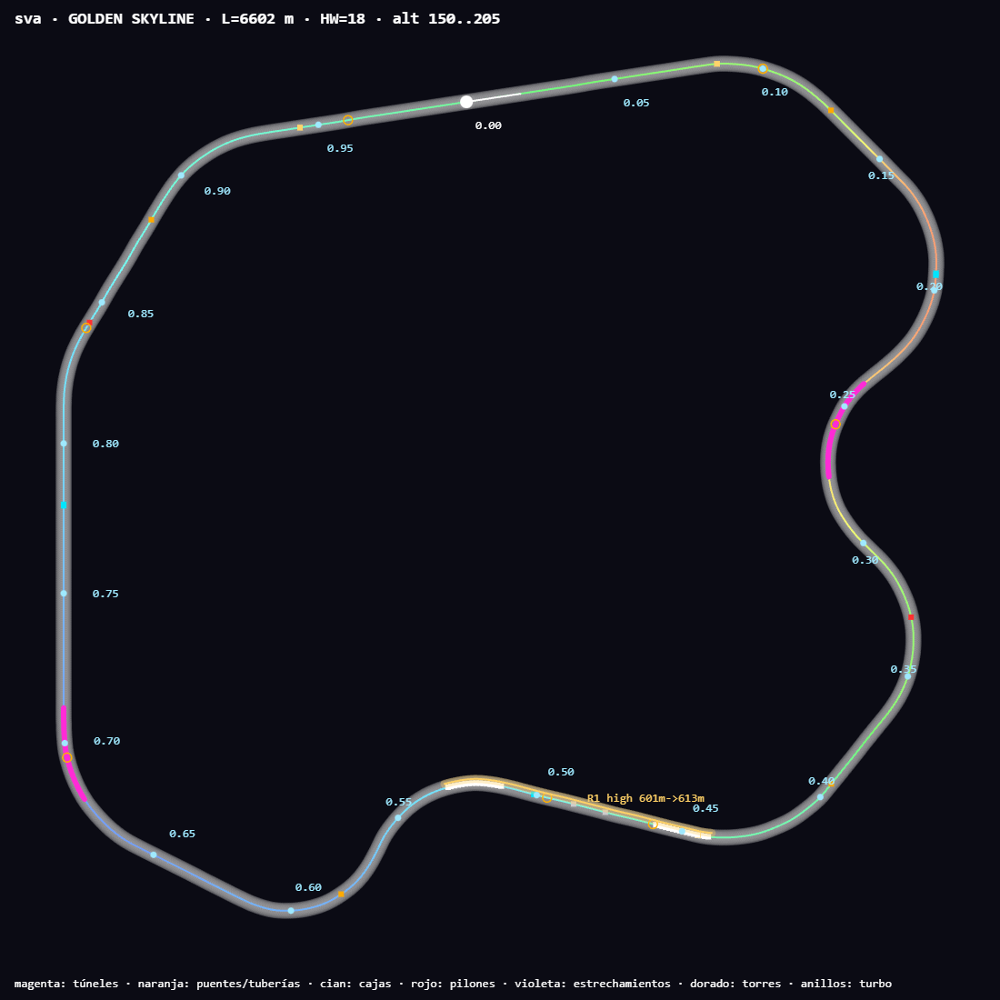

| ID | Nombre | Tipo/lado | a → b | Principal m | Ramal real m | Tiempo ramal/avenida s (n) |
| --- | --- | --- | --- | ---: | ---: | --- |
| sva:R1 | PUENTE DORADO | high/derecha | 0.44 → 0.531 | 600.77 | 612.78 | 4.49 (40) / 4.05 (25) |

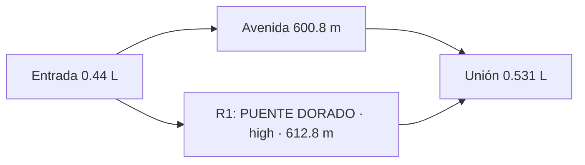

Banda propia -5..8 m, semiancho 9 m; 2 obstáculos, 1 pads y 0 strips definidos. Separación física sSep=3033.00, unión física sJoin=3377.44. routeValidate: sin conflictos detectados. Ambos recorridos tienen pruebas dirigidas, progreso y respawn. La decoración/cámara se capturó en navegador; su comodidad requiere prueba manual.

## svb — ROYAL EXPRESS

Seed de geometría: `88153`. L=6901.15 m; semiancho 18 m; tráfico inicial de la captura 29. Las pruebas de carrera se registran por separado.

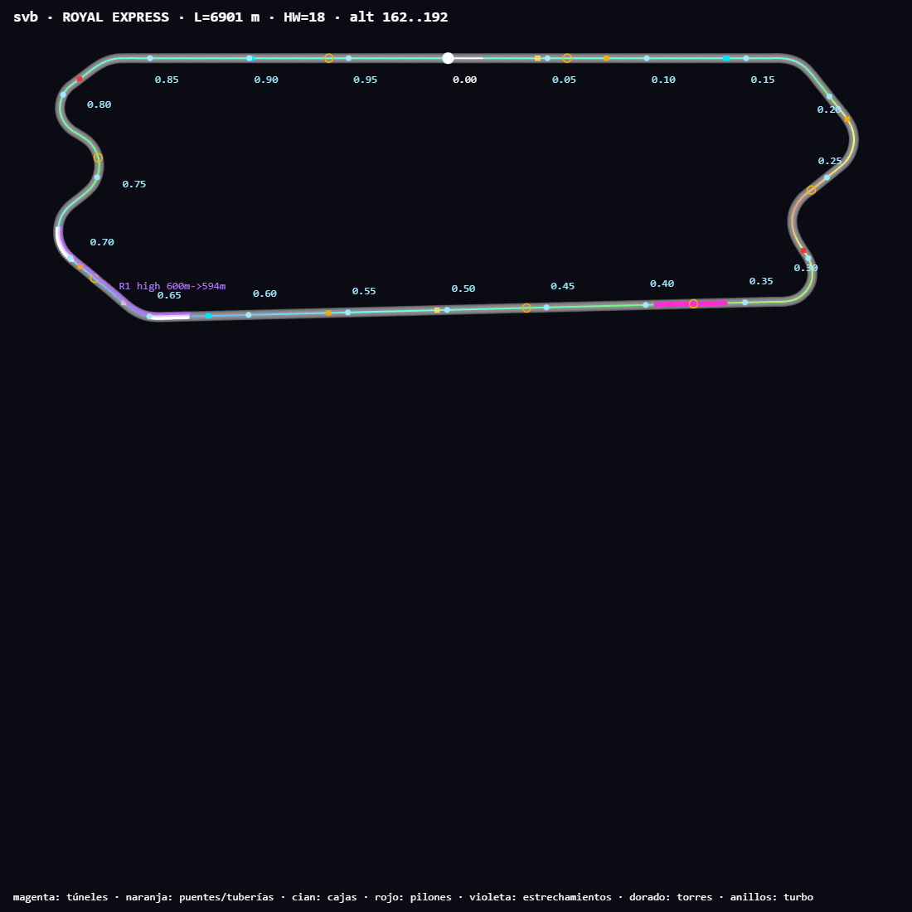

| ID | Nombre | Tipo/lado | a → b | Principal m | Ramal real m | Tiempo ramal/avenida s (n) |
| --- | --- | --- | --- | ---: | ---: | --- |
| svb:R1 | CARRIL REAL | high/derecha | 0.63 → 0.717 | 600.40 | 594.05 | 3.99 (53) / 3.75 (15) |

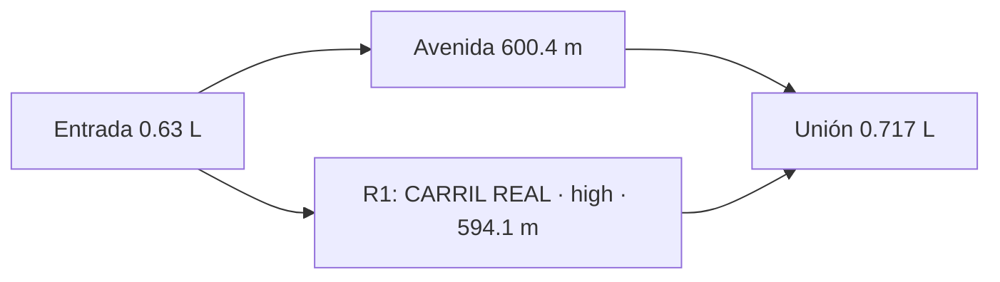

Banda propia -5..8 m, semiancho 9 m; 1 obstáculos, 1 pads y 1 strips definidos. Separación física sSep=4475.81, unión física sJoin=4820.04. routeValidate: sin conflictos detectados. Ambos recorridos tienen pruebas dirigidas, progreso y respawn. La decoración/cámara se capturó en navegador; su comodidad requiere prueba manual.

## svc — SOVEREIGN'S THRONE

Seed de geometría: `99163`. L=7603.47 m; semiancho 18 m; tráfico inicial de la captura 31. Las pruebas de carrera se registran por separado.

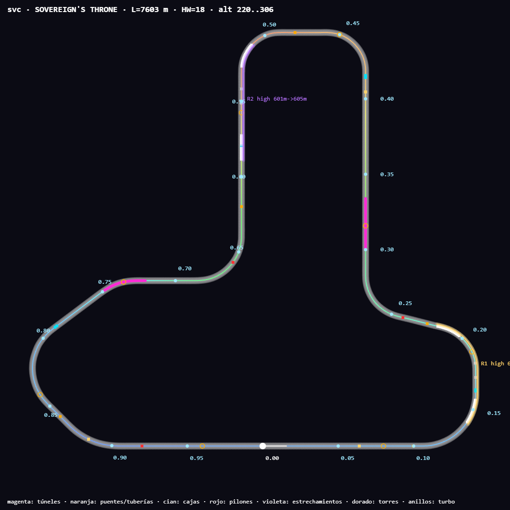

| ID | Nombre | Tipo/lado | a → b | Principal m | Ramal real m | Tiempo ramal/avenida s (n) |
| --- | --- | --- | --- | ---: | ---: | --- |
| svc:R1 | TERRAZA CORPORATIVA | high/derecha | 0.14 → 0.219 | 600.67 | 627.93 | 4.33 (14) / 4.19 (22) |

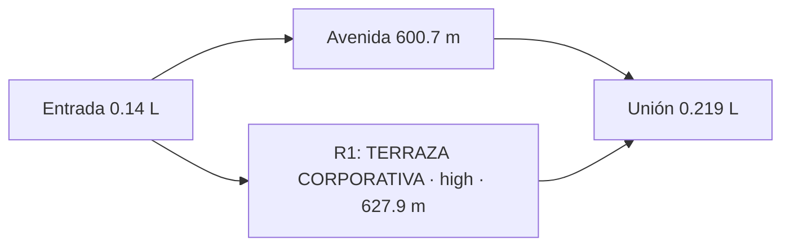

Banda propia -5..8 m, semiancho 9 m; 2 obstáculos, 1 pads y 0 strips definidos. Separación física sSep=1192.63, unión física sJoin=1537.02. routeValidate: sin conflictos detectados. Ambos recorridos tienen pruebas dirigidas, progreso y respawn. La decoración/cámara se capturó en navegador; su comodidad requiere prueba manual.

| ID | Nombre | Tipo/lado | a → b | Principal m | Ramal real m | Tiempo ramal/avenida s (n) |
| --- | --- | --- | --- | ---: | ---: | --- |
| svc:R2 | ATAJO DEL SOBERANO | high/izquierda | 0.51 → 0.589 | 600.67 | 604.55 | 3.85 (21) / 3.69 (13) |

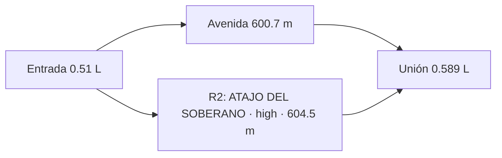

Banda propia -5..8 m, semiancho 9 m; 2 obstáculos, 1 pads y 0 strips definidos. Separación física sSep=4005.91, unión física sJoin=4350.30. routeValidate: sin conflictos detectados. Ambos recorridos tienen pruebas dirigidas, progreso y respawn. La decoración/cámara se capturó en navegador; su comodidad requiere prueba manual.

## orb — THE CROWN

Seed de geometría: `12345`. L=8508.74 m; semiancho 17 m; tráfico inicial de la captura 26. Las pruebas de carrera se registran por separado.

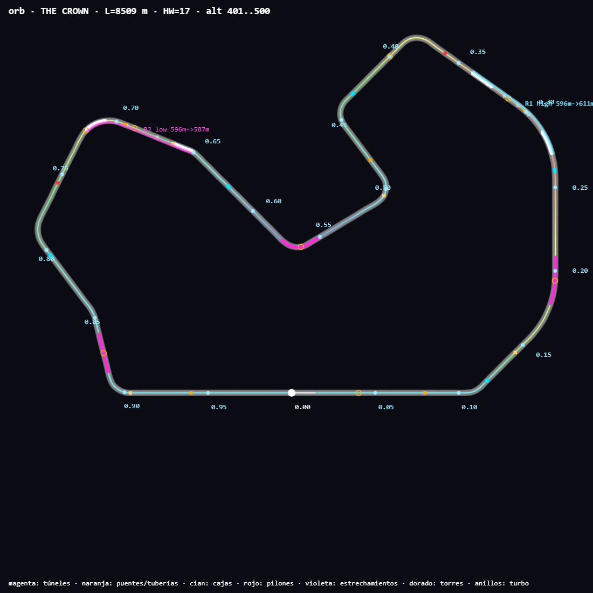

| ID | Nombre | Tipo/lado | a → b | Principal m | Ramal real m | Tiempo ramal/avenida s (n) |
| --- | --- | --- | --- | ---: | ---: | --- |
| orb:R1 | CORREDOR ORBITAL SUPERIOR | high/derecha | 0.27 → 0.34 | 595.61 | 610.84 | 3.86 (43) / 3.94 (25) |

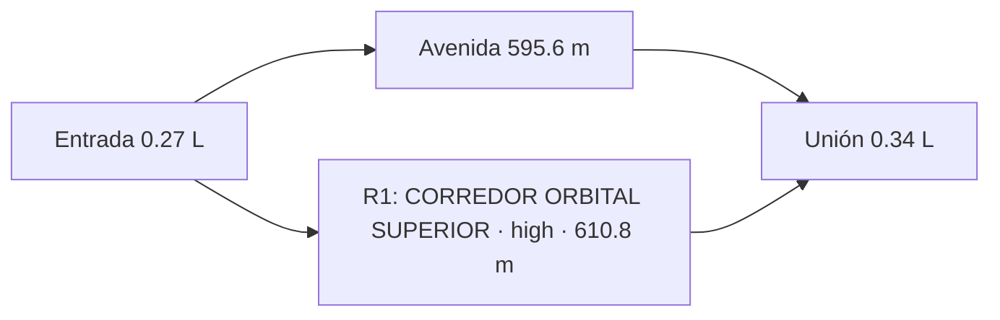

Banda propia -5..8 m, semiancho 9 m; 3 obstáculos, 1 pads y 0 strips definidos. Separación física sSep=2423.28, unión física sJoin=2767.05. routeValidate: sin conflictos detectados. Ambos recorridos tienen pruebas dirigidas, progreso y respawn. La decoración/cámara se capturó en navegador; su comodidad requiere prueba manual.

| ID | Nombre | Tipo/lado | a → b | Principal m | Ramal real m | Tiempo ramal/avenida s (n) |
| --- | --- | --- | --- | ---: | ---: | --- |
| orb:R2 | PASO INFERIOR DEL PUERTO | low/izquierda | 0.65 → 0.72 | 595.61 | 586.51 | 3.92 (36) / 3.96 (33) |

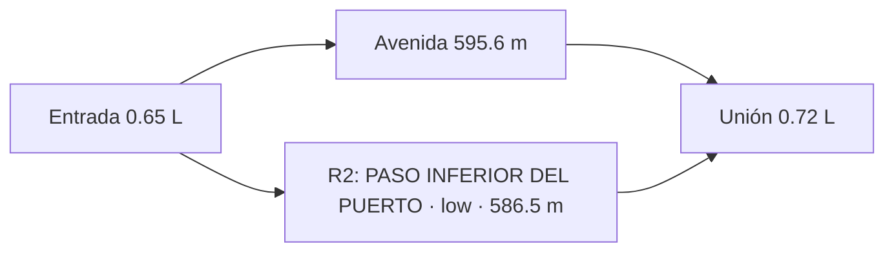

Banda propia -4..5 m, semiancho 8 m; 2 obstáculos, 1 pads y 0 strips definidos. Separación física sSep=5644.61, unión física sJoin=6012.37. routeValidate: sin conflictos detectados. Ambos recorridos tienen pruebas dirigidas, progreso y respawn. La decoración/cámara se capturó en navegador; su comodidad requiere prueba manual.

